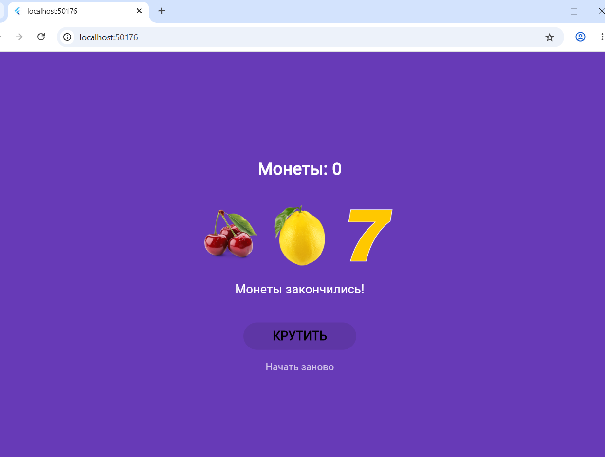

# Лабораторная работа №9. Flutter: слот-машина

 Перехрест Саша группы исп-242
02.11.26

## Что изучили:
1. разницу между StatelessWidget и StatefulWidget, и зачем нужно хранить состояние
2. как обновлять интерфейс при помощи setState()
3. как подключать локальные картинки через pubspec.yaml и папку assets
4. как писать асинхронный код (async/await, Future.delayed) и делать задержки

## Скриншот финального приложения:

## Инструкция по запуску:
1. склонировать репозиторий:
   `git clone https://github.com/Alexandraa19/Flutter_Lab9.git`
2. Перейдите в папку с проектом:
   `cd slot_machine_perehrest`
3. необходимые зависимости:
   `flutter pub get`
4. запустить проект в браузере Chrome:
   `flutter run -d chrome`